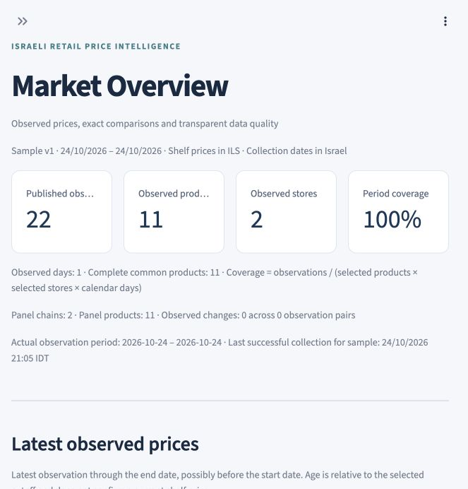
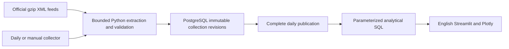

# Israeli Retail Price Intelligence

IRPI is an English retail pricing analytics application built with Python, PostgreSQL,
Streamlit and Plotly. It collects official Israeli supermarket publications,
preserves genuine observations and answers reproducible questions about matched
products, fixed baskets, category gaps and observed price changes.

**Status: published source, working local pilot; public hosting remains pending.**

[GitHub repository](https://github.com/Amir-Zecharia/israeli-retail-price-intelligence) · [Verified CI run](https://github.com/Amir-Zecharia/israeli-retail-price-intelligence/actions/runs/40177066835)

There is currently no verified public demo URL. The initial genuine
snapshot covers 24 October 2026: two chains, one source branch per chain, eleven
products and 22 published prices. A same-day revision preserves provenance without
creating an extra day of history. This convenience sample does not represent the
Israeli market.

## Why this project

A cheap-looking basket can result from missing items, different packages or changing
branch selections. IRPI makes identity, coverage and observation dates visible.
It preserves exact matched identities, requires complete baskets for comparable
totals, exposes collection failures and separates observed facts from hypotheses.
One-day history is shown as insufficient for price stability analysis.

## Run locally

Prerequisites: Python **3.12**, PostgreSQL **17** binaries (`initdb`, `pg_ctl`, `psql`,
`createdb`, `pg_dump`), and network access for initial dependency installation and
optional fresh collection. Set `PG_BIN` to the PostgreSQL binary directory if it is
not on PATH or at a supported Homebrew/Linux installation path. Commands below run
from the project root; run PostgreSQL as your regular local user.

```sh
python3.12 -m venv .venv
.venv/bin/python -m pip install -r requirements.txt
.venv/bin/python scripts/local.py setup
.venv/bin/python scripts/local.py status
.venv/bin/python scripts/local.py test
.venv/bin/python scripts/local.py start
```

Open [the local dashboard](http://127.0.0.1:8501). The start command stays in the
foreground; stop Streamlit with Ctrl+C. Use `start --port 8502` if necessary.

`setup` initializes a private project-owned PostgreSQL cluster under `.local/`,
creates separate real/test databases, applies checked migrations and prepares a
read-only dashboard login. The Unix socket directory is private; PostgreSQL does
not listen on TCP. The helper's local trust authentication is intended only for
this private local setup, not hosting. If an ignored `data/local_snapshot.sql`
exists on first setup, it restores the genuine saved database; an ordinary source
checkout has no bundled provider-data snapshot and starts empty.

```sh
# Collect the real current pilot; needs accessible official publisher endpoints.
.venv/bin/python scripts/local.py ingest
# Save a private genuine-data snapshot, excluded from Git.
.venv/bin/python scripts/local.py backup
# Report published observations/dates, or stop the project-owned database.
.venv/bin/python scripts/local.py status
.venv/bin/python scripts/local.py stop
```

Collection failures remain recorded and cannot replace a previously published
complete snapshot. `setup`, `start`, `test`, `ingest`, `backup` and `status` ensure
the local database is available. Back up before deleting `.local/`; those files are
local state, not reproducible source code. Secrets and snapshots are excluded by
`.gitignore`. The project does not load `.env` automatically; either use the helper
or export variables/configure Streamlit secrets as documented in
[deployment](docs/deployment.md).

## Explore the application

The six English routes are Market Overview, Retailer Comparison, Product Price
History, Basket Comparison, Pricing Behavior, and Data Quality & Methodology.
They offer product/barcode search, chain/branch/category/date filters, interactive
Plotly charts, formula-safe CSV exports, sample sizes and freshness. The dashboard
uses dedicated read-only credentials and never fetches provider feeds on visits.
See [dashboard behavior and testing](docs/dashboard.md).

Actual local overview screenshot:



This image documents the running local application, not a public deployment.

## Architecture and database



PostgreSQL was chosen for transactional integrity, relational identity constraints,
exact NUMERIC currency, window functions, reproducible analytical SQL and a clear
read/write permission boundary. It computes comparisons and metrics; Pandas handles
presentation. The normalized schema separates sources, chains, stores, products,
versioned samples/baskets, runs, files, observations and quality issues. Historical
labels are immutable snapshots, and provenance includes file hashes and timestamps.

See [architecture](docs/architecture.md), [data dictionary](docs/data_dictionary.md),
[methodology](docs/methodology.md), and [source feasibility](docs/source_feasibility.md).
Official Shufersal and Carrefour feeds are the implemented sources. PriceIL is an
evaluated fallback candidate, not an implemented redundant source.

## SQL and genuine findings

Eight dedicated analyses implement latest prices, LAG changes, matched retailer
comparisons, volatility, category gaps, baskets, explainable anomalies and separate
retailer profile measures. Additional SQL computes overview and collection quality.
Filters are parameterized; output is bounded. NULL indicates insufficient evidence
or missing data rather than zero prices. [SQL analysis](docs/sql_analysis.md)
defines every measure and documents PostgreSQL fixture checks and actual EXPLAIN
ANALYZE measurements.

These three cross-sectional questions use the genuine **24 October 2026** pilot,
with eleven matched products and one selected source branch for each chain:

| Business question | Observed SQL result | Interpretation limit |
|---|---|---|
| Which selected store has the cheaper complete eleven-item basket? | Shufersal ₪132.80; Carrefour ₪109.40; gap ₪23.40; both 11/11 items | One quantity per fixed product; not a national chain ranking or a claim of consistently cheaper prices |
| Which sampled category has the larger per-product gap? | Packaged food: nine matched products, mean ₪2.22 and median 31.11% gap. Dairy/substitutes: two products, mean ₪1.70 and median 17.73% gap | Shufersal minus Carrefour; percentages are median paired product gaps, not spending-weighted basket premiums |
| Which matched product has the largest relative gap? | Kinder Bueno 2×21.5g: ₪7.90 versus ₪4.90; gap ₪3.00 or 61.22% | Eleven-product pilot; observed feed prices, not guaranteed checkout or promotion-adjusted prices |

There are zero temporal transitions and only one branch per chain. Price stability,
frequent-change rankings and within-chain branch variability are therefore
unavailable until genuine observations and coverage accrue. No synthetic history
is inserted into the real database.

## Tests and operation

`local.py test` runs parsing/identity/failure tests, actual PostgreSQL constraints,
transaction and concurrency tests, hand-calculated SQL fixtures and Streamlit
smoke tests. The real and fixture databases are separate. Local dashboard database
smoke checks use SELECT-only credentials. See the [acceptance matrix](docs/acceptance_matrix.md)
for evidence and pending gates, and the [development log](docs/development_log.md)
for recorded test counts.

`.github/workflows/ci.yml` prepares push/PR CI with PostgreSQL 17.
`daily_ingestion.yml` prepares daily ingestion and manual recovery;
`source_probe.yml` prepares hosted source diagnostics. The first hosted CI run passed with 52 tests and one optional local-data check skipped; all 53 tests passed locally. The daily schedule has not yet been verified. [Deployment instructions](docs/deployment.md)
cover the remaining Supabase, GitHub Actions and Streamlit setup and verification.
The English source has been published after local review and explicit authorization. Hosted database and dashboard deployment remain separate steps.

## Limitations and next steps

The current panel is small, dominated by confectionery, and has unverified
geographic branch metadata. The hosted source probe parsed 5,974 Shufersal records, but Carrefour timed out; the two-source cloud gate remains unmet. Public deployment, current service quotas and scheduled execution remain pending.
See [limitations](docs/limitations.md). Next: review the local app, verify hosted
access and deployment when authorized, then expand fixed sample versions and accrue
genuine history. Optional weekly reports and composite scores remain deferred.

## License and attribution

Original project code is MIT licensed; see [LICENSE](LICENSE). That license does
not grant rights to third-party retail data, brands or upstream software. Official
publications retain their own applicable terms; see source feasibility and verify
terms before broader collection or redistribution. Local snapshots are private
and excluded from the source repository.
