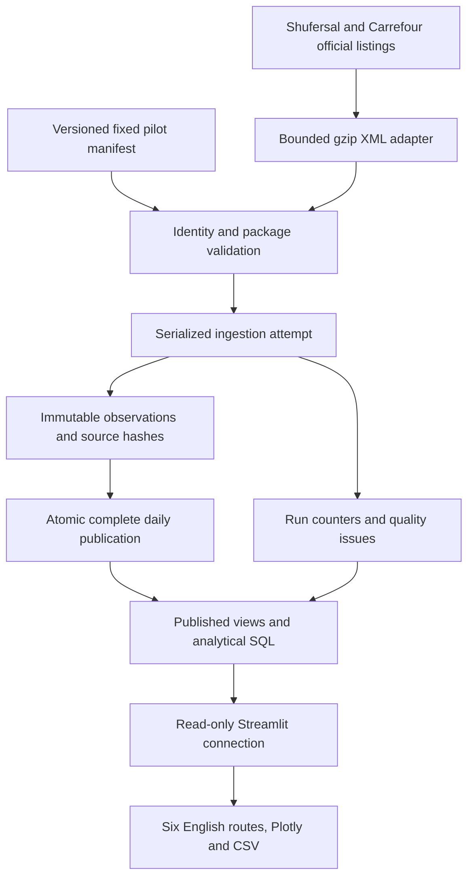

# System architecture

IRPI separates collection, relational integrity, analytical computation and
presentation. The current verified environment is local PostgreSQL 17 plus Python
3.12. The intended hosted architecture is Supabase, GitHub Actions and Streamlit
Community Cloud; those services have not been verified as deployed.

`pipeline/extract` owns network/source parsing; `pipeline/ingest.py` validates and
loads the controlled panel. An advisory lock serializes attempts. Transactional
revision publication preserves old records and exposes only one complete daily
revision to analysis. Partial and failed attempts remain visible in quality status.

`database/migrations` reproduces constraints, roles and views. Applied migration
checksums cannot change; additive migrations extend the schema. `database/analytics`
contains standalone parameterized SQL, with `database/analytics.py` as the bounded
service contract. Joins, LAG, medians, conditional aggregation, date arithmetic and
fixed-panel eligibility execute in PostgreSQL. Product/store/category labels use
immutable observation snapshots where available.

`app/main.py`, `app/data.py` and `app/ui.py` implement navigation, SQL access and
presentation. Six routes share explicit filters and freshness semantics. Cache keys
include all query arguments and the connection; the refresh control clears caches.
The dashboard connection has SELECT-only access to approved data. It never downloads
price feeds. Display timestamps use Asia/Jerusalem; collection instants are UTC.

`scripts/local.py` manages a private project-owned cluster, migration/bootstrap,
read-only app connection, tests, ingestion and private backups. Real observations
live in irpi_local; synthetic fixtures live in irpi_test. `.local/`, `data/`, secret
files and raw artifacts are ignored. An optional private backup is restored only
when creating a fresh local real database; source checkout alone begins empty.

See the data dictionary for entities, methodology for sample and revision semantics,
SQL analysis for measures/performance, and deployment for the hosted permission and
operational boundary. Adding more providers requires a real tested adapter; an
unimplemented fallback is not source redundancy.
